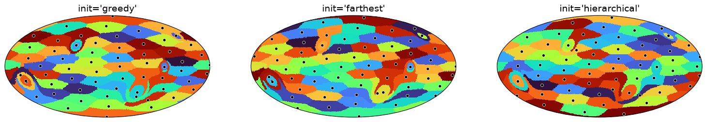
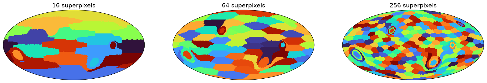
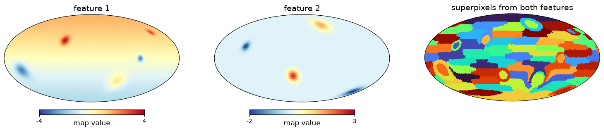
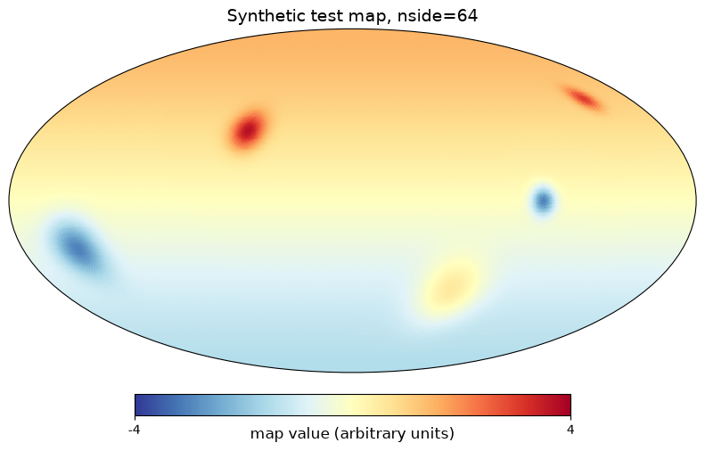
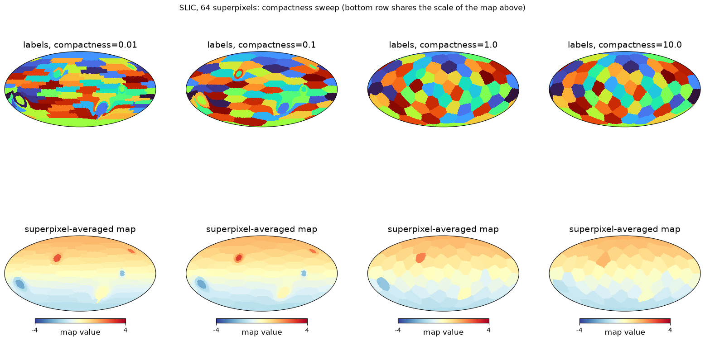
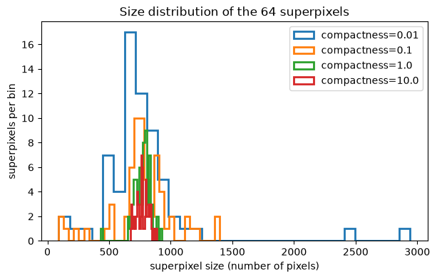
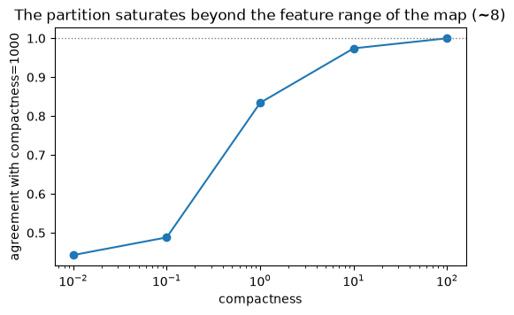
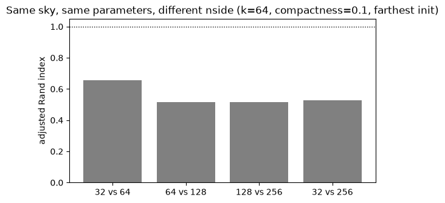
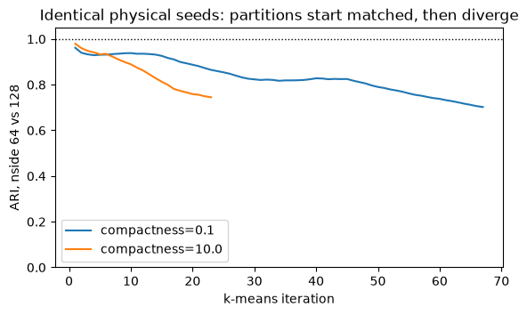
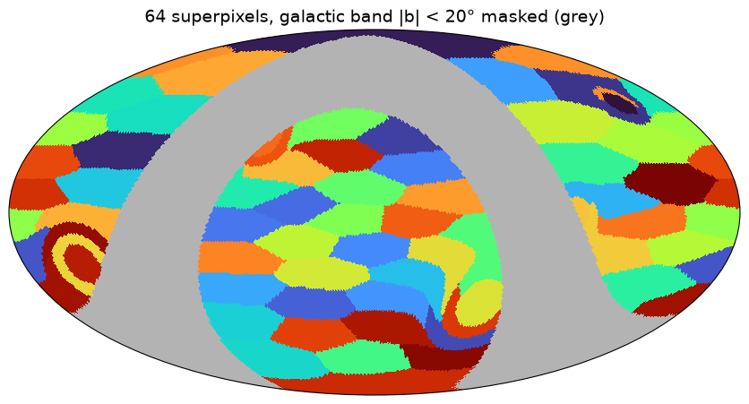

A recent [healpy issue](https://github.com/healpy/healpy/issues/1131) proposes a `slic` function
that generates superpixels on the HEALPix grid, adapting the SLIC algorithm to the sphere, with a
complete working implementation attached. This post is what I found testing it.

## What are superpixels, and what is SLIC?

In 2D image processing, superpixels oversegment an image into a few hundred small, contiguous
regions that group neighbouring pixels with similar values: instead of working with millions of
pixels, a downstream classifier or segmenter works with a few hundred coherent regions that
mostly respect image edges.

SLIC ([Achanta et al. 2012](https://doi.org/10.1109/TPAMI.2012.120)) is the most widely used
superpixel algorithm, an adapted k-means: each pixel is assigned to the cluster centre minimising
a joint feature + spatial distance

$$D = \sqrt{(d_{\mathrm{feature}} / c)^2 + (d_{\mathrm{spatial}} / S)^2}$$

where $d_{\mathrm{feature}}$ is the difference in map value(s), $d_{\mathrm{spatial}}$ is the
angular distance between pixel and centre (the spherical twist), $c$ is the compactness
parameter, and $S \simeq 2\sqrt{f/k}$ is the nominal spacing of $k$ superpixels covering a valid
fraction $f$ of the sphere.

- Large compactness: the spatial term dominates and superpixels become compact, regular and
  grid-like.
- Small compactness: superpixels follow the contours of the map.
- Only pixels within 2S of a centre are compared, so an iteration costs ~O(npix): this local
  search is what makes SLIC fast, also on the sphere.

The proposed implementation works directly on the HEALPix grid in RING or NESTED ordering,
supports masked maps and multi-feature stacks, and offers three ways to place the initial
centres: greedy k-means++ seeding (random), farthest-point sampling, and hierarchical seeding at
the centres of the coarser HEALPix level closest to the requested number of segments
(deterministic and ordering-independent). The same idea exists in the computer-vision literature
as SphSLIC, for 360-degree panoramic images (Zhao et al. 2018).

The three initialisation strategies converge to very similar partitions (black dots are the
final centres of each superpixel):

More superpixels just shrink the regions:

Clustering can also run on a stack of maps, in the combined feature space:

## Findings

All examples use a synthetic nside=64 map, a large-scale gradient plus Gaussian blobs:

- Compactness is the knob: at 0.01 superpixels stretch along map contours and the
  superpixel-averaged map is nearly identical to the input; at 10 the segmentation degenerates
  into a quasi-regular sky partition, a fancier ud_grade. Intermediate values give roughly round
  superpixels that still snap to strong edges.

  Top row: superpixel labels. Bottom row: superpixel-averaged map, same colour scale as the test
  map:

  

  Size distributions tell the same story, regular cells at high compactness, all scales at low
  compactness:

  

  The knob saturates beyond the feature range of the map, about 8 here, as the proposal author
  pointed out; with features normalised to [0, 1] the interesting range would simply be 0 to 1:

  
- Fast: nside=256 (786,432 pixels), 64 superpixels, ~29 s.
- RING vs NESTED: hierarchical seeding is ordering-independent by construction, but the original
  attachment gave partitions 87% identical instead of 100%, for three reasons: exact gradient
  ties in the low-gradient nudge broken by candidate order, pix2vec not being bitwise
  reproducible across orderings, and map-order accumulation of the update sums. Three small
  fixes (RING-index tie-break, canonical pixel vectors, canonical accumulation order) make the
  partitions bit-identical.
- Not resolution-invariant: the same analytic map at nside 32 to 256 with the same k and
  compactness gives statistically equivalent but spatially different partitions (adjusted Rand
  index 0.5 to 0.9). Fixed physical seeds barely help; skipping the low-gradient nudge helps
  most in the spatial regime; the residual is k-means settling into different, equally good
  local minima on different pixel grids. Fine for region statistics at one resolution, but do
  not expect to track structures across resolutions:

  

  Two follow-up experiments pin down the mechanism: from identical physical seeds the very first
  assignment already agrees at ARI 0.96 to 0.98 and the agreement decays iteration by iteration
  (the pixel grid itself is the perturbation that steers the k-means), while the quality of the
  final partitions is the same at every resolution, within-superpixel feature RMS and angular
  radius constant to within a percent. Different but equally good local minima; plain 2D SLIC is
  not resolution-invariant either, so this is the algorithm, not a bug:

  
- compactness=0 gives divide-by-zero warnings and an all-unassigned result; negative values
  silently behave like their absolute value (the feature term is squared). Needs validation.
- compactness carries the units of the map: scaling the map by 1000 with the same compactness
  drops agreement to 61%; scaling compactness along with the map reproduces the segmentation
  exactly. A CMB map in K vs uK needs completely different values, so normalising features
  internally would make compactness dimensionless.
- Connectivity is not guaranteed (inherent to SLIC, same in 2D): 3/64 superpixels came out
  spatially disconnected. SNIC (Achanta & Sustrunk 2017) enforces connectivity if needed.
- Duplicate centres can occur after the seed nudge, silently giving fewer superpixels than
  requested.
- Sparse masks are fine: the nominal spacing is rescaled by the valid fraction, and a polar-cap
  test assigned 100% of valid pixels with all clusters used.

  Here a 40-degree galactic band is masked out (grey):

  

## Verdict

Works, fast, sensible segmentations; init='hierarchical' is a good deterministic default. Worth
discussing in the issue: naming (hp.slic vs superpixels()), internal feature normalisation,
exposing per-superpixel means as an output, citing Zhao et al. (2018) as prior art.

The proposal author reviewed these tests, confirmed the usage and the fix list, and will review
the PR implementing the fixes.

## References

- Achanta et al. (2012), SLIC Superpixels Compared to State-of-the-Art Superpixel Methods, IEEE
  TPAMI 34(11), 2274-2282:
  https://doi.org/10.1109/TPAMI.2012.120
- Ren & Malik (2003), Learning a Classification Model for Segmentation, IEEE ICCV:
  https://www2.eecs.berkeley.edu/Research/Projects/CS/vision/grouping/papers/ren_malik_iccv03.pdf
- Arthur & Vassilvitskii (2007), k-means++: The Advantages of Careful Seeding, ACM-SIAM SODA:
  https://theory.stanford.edu/~sergei/papers/kMeansPP-soda.pdf
- Zhao et al. (2018), Spherical Superpixel Segmentation, IEEE Trans. Multimedia 20(6), 1406-1417:
  https://doi.org/10.1109/TMM.2017.2772842
- Wan et al. (2018), Spherical Superpixels: Benchmark and Evaluation, ACCV, LNCS 11366, 703-717:
  http://cic.tju.edu.cn/faculty/lwan/paper/sphsp18/SphSP.html
- Giraud et al. (2020), Generalized Shortest Path-based Superpixels for Accurate Segmentation of
  Spherical Images, ICPR:
  https://arxiv.org/abs/2004.07394
  (journal version, Pattern Recognition 2023: https://arxiv.org/abs/2509.19895)
- Achanta & Sustrunk (2017), Superpixels and Polygons Using Simple Non-Iterative Clustering,
  IEEE CVPR:
  https://openaccess.thecvf.com/content_cvpr_2017/html/Achanta_Superpixels_and_Polygons_CVPR_2017_paper.html
- Stutz et al. (2018), Superpixels: An Evaluation of the State-of-the-Art, CVIU 166, 1-27:
  https://arxiv.org/abs/1612.01601
- Gorski et al. (2005), HEALPix, ApJ 622, 759-771:
  https://doi.org/10.1086/427976
