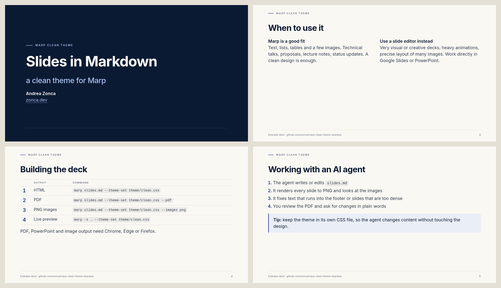

Most of what I write is now Markdown: documentation, notes, READMEs, blog posts and the instruction
files I give to AI agents. Presentations used to be the exception, sitting in Google Slides or
PowerPoint where an agent cannot easily read or edit them. With [Marp](https://marp.app) the slides
are just another Markdown file in the repository, next to the documents they come from, and the
same agent that edits the documentation can edit the deck. Marp then builds it to HTML or PDF.

I prepared a clean theme and a short example deck you can copy:
[github.com/zonca/marp-clean-theme-example](https://github.com/zonca/marp-clean-theme-example),
with a [live HTML version](https://zonca.github.io/marp-clean-theme-example/) and a
[PDF](https://github.com/zonca/marp-clean-theme-example/blob/main/slides.pdf).



---

## When Marp is the right tool, and when it is not

Marp is not a replacement for a slide editor. If the deck must be very visual or creative, with
precise placement of many images, custom graphics or animations, work directly in Google Slides or
PowerPoint.

Most of my decks are not like that: they are text, lists, tables and a few images, and they need a
clean, consistent design rather than a creative one. Technical talks, lecture notes, project
updates and proposals all fall in this group. For these, Markdown has clear advantages:

- the deck lives in the same repository as the documentation and notes it is based on;
- every change is a readable diff in git;
- an AI agent reads and edits it like any other file, and has the rest of the project as context;
- the design lives in a separate CSS theme, so the content and the look are changed independently.

A theme with a real brand behind it follows the same pattern. For the San Diego Supercomputer Center
I extracted the colours, the fonts, the geometry and the logos from the official PowerPoint template
and rebuilt it as a CSS theme:
[A Marp theme that reproduces the official SDSC slide template](./2026-11-03-sdsc-marp-theme.md),
with the [theme repository](https://github.com/zonca/sdsc-marp-theme) and a
[live preview of the demo deck](https://zonca.github.io/sdsc-marp-theme/).

---

## What a Marp deck looks like

A deck is a Markdown file with a front matter block, and `---` separates slides:

```markdown
---
marp: true
theme: clean
paginate: true
header: 'MARP CLEAN THEME'
footer: 'Example deck'
---

<!-- _class: lead -->

# Slides in Markdown
## a clean theme for Marp

---

## Why Markdown slides

- The deck is a plain text file
- Every change is a readable diff in git

<!--
Presenter notes are HTML comments.
-->
```

Directives starting with an underscore, such as `<!-- _class: lead -->`, apply to one slide only.
HTML comments that are not directives become presenter notes.

---

## A clean theme

The theme in the example repository, `theme/clean.css`, builds on the Marp default theme. It uses
the Inter font, a navy accent on a warm off-white background, a small uppercase header, a thin rule
above the footer, tables with light horizontal rules, a callout box and dark title and closing
slides. A few classes cover the common layouts: `lead` for title slides, `dense` for slides with
more text, a `cols` block for two columns and a `box` block for a callout.

A few things I learned while customizing the default theme:

- **Content is vertically centered** by the default theme through `place-content`, so setting
  `justify-content` has no effect. To start content slides at the top while keeping title slides
  centered:

  ```css
  section:not(.lead) { place-content: safe start stretch !important; }
  ```

- **Table borders and zebra stripes** from the default theme win over plain `table`, `th` and `td`
  rules. Prefix the selectors with `section` (and use `!important` for the side borders) to replace
  them.
- **The preview server caches the theme** when it starts: after editing the CSS, restart
  `marp -s`, otherwise you keep looking at the old design.
- **A local theme** is loaded with `--theme-set theme/clean.css` and selected with `theme: clean`
  in the front matter, matching the `/* @theme clean */` comment at the top of the CSS file.

---

## Building the deck

The [Marp command line tool](https://github.com/marp-team/marp-cli) needs Node.js 18 or later:

```bash
# HTML, the default output
npx @marp-team/marp-cli@latest slides.md --theme-set theme/clean.css

# PDF
npx @marp-team/marp-cli@latest slides.md --theme-set theme/clean.css --pdf

# one PNG per slide
npx @marp-team/marp-cli@latest slides.md --theme-set theme/clean.css --images png

# live preview server, re-rendered on every change
npx @marp-team/marp-cli@latest -s . --theme-set theme/clean.css
```

PDF, PowerPoint and image output need Chrome, Edge or Firefox. If none is found, point
`CHROME_PATH` to a browser executable, for example the Chromium installed by Playwright. Links stay
clickable in the PDF.

Other options worth knowing:

- `--pptx` builds a PowerPoint file, useful when someone needs the deck in that format; the
  experimental `--pptx-editable` produces editable slides through LibreOffice, with lower fidelity;
- `--pdf-notes` keeps the presenter notes as PDF annotations, and `--pdf-outlines` adds bookmarks;
- with the preview server, adding `?pdf` or `?pptx` to the URL of a deck downloads that format;
- there is a [VS Code extension](https://marketplace.visualstudio.com/items?itemName=marp-team.marp-vscode)
  with a live preview, and an official
  [Docker image](https://hub.docker.com/r/marpteam/marp-cli).

The example repository wraps these commands in a `Makefile` and has a GitHub Actions workflow that
builds the HTML and PDF and publishes them to GitHub Pages on every push. I commit the Markdown and
the final PDF, not the generated HTML.

---

## Working on the deck with an AI agent

The workflow I use with coding agents such as Claude Code:

1. the agent writes or edits `slides.md`, using the documents in the repository as sources;
2. it renders every slide to PNG with `--images png` and looks at the images;
3. it fixes slides where text runs into the footer, or that are too dense, by trimming text or
   switching to the `dense` class;
4. I review the PDF and ask for changes in plain words, and the cycle repeats.

The second step matters: Marp does not warn when content overflows a slide, but an agent that can
read images catches it before I do. Keeping the theme in its own file also means I can ask for
content changes without the agent touching the design.

Others have described a similar workflow, for example
[using Claude Code and Marp to think through presentations](https://www.freecodecamp.org/news/how-to-use-claude-code-and-marp-to-think-through-presentations/).

To start your own deck, copy `theme/clean.css` and `slides.md` from the
[example repository](https://github.com/zonca/marp-clean-theme-example).
