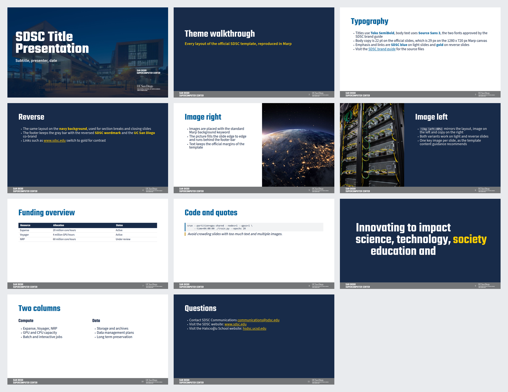
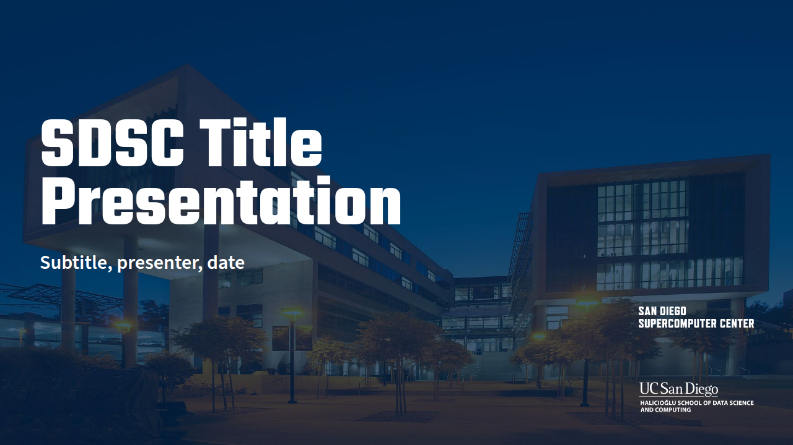

I recently built an open source Marp theme that reproduces the official San Diego Supercomputer
Center (SDSC) slide template. This allows you to write your presentations in Markdown and have
them look exactly like the official branded PowerPoint template, without actually having to use
PowerPoint.

This is the companion of my other post,
[Write slides in Markdown with Marp when working with AI agents](./2026-11-03-markdown-slides-marp-ai-agents.md),
where I explain the general workflow and the basics of building a deck with Marp and a custom CSS
theme. Here the focus is on the brand: where every value of the theme comes from, and how to apply
it to a real template.



## Why a Marp theme for the SDSC template?

For the SDSC tutorial and other SDSC talks I needed the slides to adhere strictly to the official
branded template, but I wanted to keep writing them in Markdown with [Marp](https://marp.app/). The
theme gives me that branded look directly from the Markdown source, and the Markdown deck and the
PowerPoint deck end up looking the same.

I published an [interactive HTML preview of the 11 slide demo
deck](https://zonca.github.io/sdsc-marp-theme/) (navigate it with the arrow keys, it is a single
self-contained HTML file) so anyone can see the result before installing anything, and there is also
a [PDF of the same deck](https://zonca.github.io/sdsc-marp-theme/deck.pdf).

The theme lives in a public GitHub repository at
[https://github.com/zonca/sdsc-marp-theme](https://github.com/zonca/sdsc-marp-theme). The code is
MIT licensed, though all brand assets remain the property of SDSC and UC San Diego. The source of
the demo deck is in the `demo/` folder of the repository.

## Building the theme from the source of truth



Instead of approximating the brand values by eye, I extracted the real values directly from the
official source of truth: the SDSC brand guide at
[https://www.sdsc.edu/about/brand.html](https://www.sdsc.edu/about/brand.html), specifically the
template file `SDSC-UCSanDiego-HSDSC.potx`.

*   **Colours**: Brand colours were extracted directly from `ppt/theme/theme1.xml` inside the
    `.potx` archive. This includes navy `#182B49` (PMS 2767), blue `#00629B`, gold `#C69214` (PMS
    1245), bright gold `#FFCD00`, footer gray `#747678`, and light gray `#E7E6E6`.
*   **Typography**: The slide master uses Teko SemiBold for headlines and Source Sans 3 for body
    text. Both are brand approved and, conveniently, both are free on Google Fonts.
*   **Geometry**: The PowerPoint master is defined as 12192000 x 6858000 EMU. This maps perfectly
    to the standard Marp canvas of 1280 x 720 px (1 px = 9525 EMU). Every element is precisely
    positioned: side margins are 88 px, the title band starts 38 px from the top and is 154 px
    tall. Body text is 22 pt (29 px) and the title is 54 pt (72 px). The footer bar is 52.5 px tall
    with the SDSC wordmark at 46 px from the left and the UC San Diego / HSDSC logo at 46 px from
    the right.
*   **Assets**: The official logos (SVG, both colour and white variants), the dusk photograph of
    the SDSC building used on the title slide, and the other brand photographs were all extracted
    directly from the `.potx` package itself (`ppt/media/`). This means the theme ships with the
    real, official assets.

## Supported layouts

The theme implements several slide layouts as CSS classes to match the PowerPoint options:

*   Default content slide
*   `title`
*   `reverse` (a navy background)
*   `section` (includes a navy divider)
*   `statement` (designed for one large, centred sentence)
*   `lead`
*   `dense` (smaller body text, for slides with more content)
*   `cols` (or `columns`) helper for two columns
*   Standard Marp background keywords are supported, such as `` for image
    right/left layouts.

A blockquote is styled as a callout, with a gold rule on the left. The theme draws its own footer
bar, so the Marp `header` and `footer` directives are not used and are hidden by the theme.

The footer bar is implemented efficiently: it's drawn with a `section::before` pseudo element that
carries the gray bar and both logos as background images. This ensures it always sits on top of full
bleed background photos, matching exactly the "Image right + copy" layout found in the PowerPoint
template.

To verify the accuracy, I rendered the official `.potx` with LibreOffice and compared it slide by
slide with the Marp output to check the title band, margins, footer bar, and logo placement. You
can find these official renders in the repository under `reference/official/` if you want to compare
them yourself.

## How to use the theme

The general workflow, writing slides in Markdown, building them with the Marp command line tool and
reviewing them with an AI agent, is covered in my other post,
[Write slides in Markdown with Marp when working with AI agents](./2026-11-03-markdown-slides-marp-ai-agents.md),
which also has a generic example repository to start from. What follows is only what is specific to
this theme:

1.  Install the two brand fonts, [Teko](https://fonts.google.com/specimen/Teko) for the headlines
    and [Source Sans 3](https://fonts.google.com/specimen/Source+Sans+3) for the body text, both
    free from Google Fonts.
2.  Copy the `themes/` and `assets/` folders from the
    [repository](https://github.com/zonca/sdsc-marp-theme) into the folder of your deck. The
    `assets/` folder holds the official logos and photographs.
3.  Point the front matter of the deck at the theme:

```markdown
---
marp: true
theme: ../themes/sdsc.css
paginate: true
size: 16:9
---
```

4.  Render it with the Marp command line tool:

```bash
npx @marp-team/marp-cli@latest deck.md --theme ../themes/sdsc.css --allow-local-files --images png
npx @marp-team/marp-cli@latest deck.md --theme ../themes/sdsc.css --allow-local-files --pdf
```

The `--allow-local-files` flag is required because the theme references the local logo and photo
files in the `assets/` folder. In Marp CLI 4 the PNG and the PDF outputs are separate options, hence
the two commands.

The theme file can also be loaded as a named theme set, the same way as in the other post, with
`npx @marp-team/marp-cli@latest deck.md --theme-set themes/sdsc.css` and `theme: sdsc` in the front
matter.

If Chrome cannot start on your machine, for example on Linux hosts where AppArmor blocks
unprivileged user namespaces and Chrome aborts with `No usable sandbox!`, the repository ships
`scripts/chrome-wrapper.sh`, a small wrapper that adds the `--no-sandbox` flag. Point Marp at it
with the `CHROME_PATH` environment variable.

---

*Note: Please refer to the SDSC brand guide for the official rules and policies regarding the reuse
of SDSC and UC San Diego logos.*
