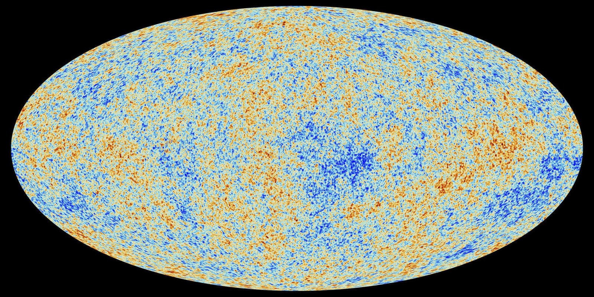
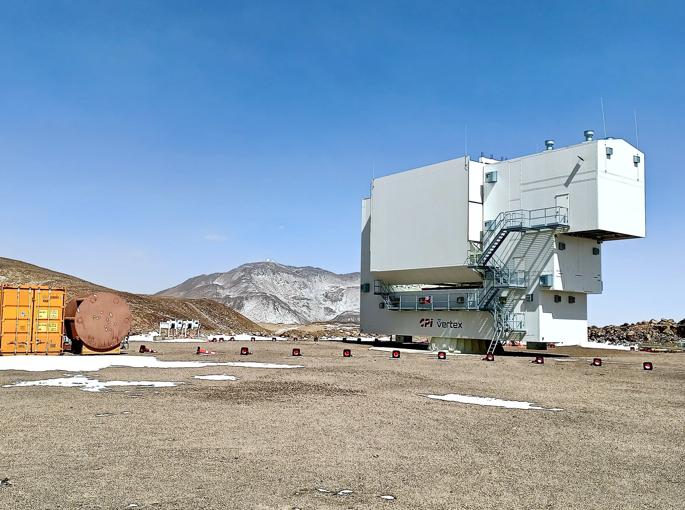

On Sunday, November 15 I am giving a talk at the [House of Italy](https://houseofitalysandiego.org/)
in Balboa Park, San Diego:

**The Cosmic Microwave Background: How the light of the Big Bang reveals the origin of our Universe**

It is one of their monthly presentations, so the talk is followed by dinner prepared by Chef Mark
Pelliccia. The talk is in English, it needs no background in Physics, and it is open to everyone,
members or not.

## Details

- **When**: Sunday, November 15, 2026, at 5:00 PM
- **Where**: Hall of Nations, 2294 Pan American Plaza, Balboa Park, San Diego
- **Price**: \$20 for House of Italy members, \$25 for guests, payable online with
  [PayPal](https://www.paypal.com/donate/?hosted_button_id=4EVTMZYCRWQ6N)
- **RSVP**: by Thursday, November 12, to houseofitaly@houseofitalysandiego.org, so the chef knows
  how many people to cook for

*The cosmic microwave background over the whole sky, as mapped by the ESA Planck satellite. Red
patches are slightly warmer, blue patches slightly colder. Image credit: ESA and the Planck
Collaboration.*

## What the talk is about

About 380,000 years after the Big Bang the universe had cooled enough for the first atoms to form,
and light could travel freely for the first time. That light is still all around us. After 13.8
billion years of cosmic expansion it has cooled to less than 3 degrees above absolute zero (about
minus 455 °F), and it reaches us as faint microwaves from every direction in the sky. It was
discovered by accident in 1965 by Arno Penzias and Robert Wilson, two radio astronomers at Bell Labs
who at first blamed the hiss in their antenna on nesting pigeons. The discovery earned them the 1978
Nobel Prize in Physics.

The map above shows that this light is almost, but not exactly, the same everywhere: it varies by
about one part in 100,000 from one patch of sky to the next. Those tiny differences are a snapshot of
the newborn universe, and the seeds from which gravity later built every galaxy. Measuring them
precisely has told us how old the universe is, and that the atoms we are made of are only about 5% of
its content: the rest is dark matter and dark energy, which we still do not understand.

In the talk I explain how we measure this light, what it has taught us so far, and what we are still
looking for: a faint pattern in its polarization that would be the imprint of gravitational waves
from the very first instant after the Big Bang.

There is also an Italian thread in this story: one of the two instruments on board Planck, the Low
Frequency Instrument, was built by an Italian-led consortium.

## About me

I am originally from Milan. I studied Aerospace Engineering at the Politecnico di Milano and got my
PhD in Physics and Astrophysics at the University of Milan, then moved to the United States in 2009,
first to Santa Barbara and then to San Diego.

Today I am a computational cosmologist at the San Diego Supercomputer Center, UC San Diego. I worked
on [Planck](https://www.cosmos.esa.int/web/planck), the European Space Agency satellite that mapped
the whole sky between 2009 and 2013, and now I work on the
[Simons Observatory](https://simonsobservatory.org/), a set of telescopes at 5,200 meters (17,000 feet) in the Atacama Desert in Chile that is now mapping the
same light with much higher sensitivity. I also maintain two open source Python packages used across the field:
[healpy](https://github.com/healpy/healpy), for working with maps of the whole sky, and
[PySM](https://github.com/galsci/pysm), for simulating the emission of our own Galaxy that
contaminates those maps.

*The Large Aperture Telescope of the Simons Observatory, in the Atacama Desert in Chile. Image
credit: Simons Observatory.*

## The House of Italy

The House of Italy is the Italian cultural society of San Diego. It was founded in 1935 for the
California Pacific International Exposition and has its cottage among the International Cottages of
Balboa Park. Besides the monthly presentations it runs open houses, December Nights, scholarships and
Italian classes. See [how to become a member](https://houseofitalysandiego.org/home/membership/).

Bring a friend, and remember to RSVP. Ci vediamo il 15, see you on the 15th!
